<p align="center">
  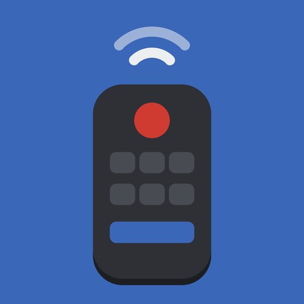
</p>

<h1 align="center">Fernbedienung</h1>

<p align="center">
  <b>Werbefreie IR-Fernbedienung für Hotel-Fernseher</b><br>
  Das Handy mit Infrarot-Sender wird zur Fernbedienung – offline, ohne Konto, ohne Werbung.
</p>

<p align="center">
  <a href="https://github.com/RolufS/IR-Remote-APK/releases/latest"></a>
  <a href="LICENSE"></a>
  
  
</p>

<p align="center">
  <a href="https://github.com/RolufS/IR-Remote-APK/releases/latest"></a>
</p>

<p align="center">
  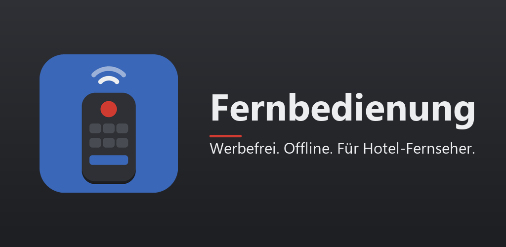
</p>

<p align="center"><a href="#english">English summary below</a></p>

## Warum?

Im Hotelzimmer fehlt die Fernbedienung, die Batterien sind leer oder man möchte sie lieber
nicht anfassen – und wer seinen Fire TV Stick mitbringt, muss trotzdem erst auf den richtigen
HDMI-Eingang umschalten. Die Fernbedienungs-Apps im Play Store sind meist voller Werbung und
Tracker. Diese App macht nur eins: Sie findet den Code für den Fernseher und sendet ihn per
Infrarot – ohne Werbung, ohne Internet, ohne Datensammeln.

## Funktionen

**🔎 Fernbedienung finden**
- Assistent: Marke wählen, MUTE antippen, „Ja“ oder „Nein“ – fertig. Danach Bestätigungstest und Eingangs-Test.
- Marke unbekannt? Ein Suchlauf sendet nacheinander Ausschalt-Befehle, bis der Fernseher ausgeht.
- HDMI 1–4 direkt, wenn der Fernseher es kann – ideal für Fire TV Stick, Chromecast & Co.

**📱 Bedienen**
- Vollbild-Fernbedienung mit Ziffern, Steuerkreuz, Farbtasten und HDMI-Reihe.
- Lautstärke und Programm laufen weiter, solange die Taste gehalten wird.
- „Weitere Tasten“ mit allen Extra-Tasten des gefundenen Codes; mehrere Fernbedienungen speichern und benennen.

**⚡ Automationen**
- Mehrere Tasten nacheinander mit einem Tipp, Wartezeit je Schritt.
- Aufnahme: Fernbedienung einfach benutzen, die App zeichnet Tasten und Pausen auf.
- Vorlagen für den Sleep-Timer des Fernsehers und ein Sleep-Timer im Handy, der den TV auch bei geschlossener App ausschaltet.

**🔒 Schnellsteuerung**
- Kacheln in den Schnelleinstellungen: Ein/Aus, leiser, lauter, Eingang – auch auf dem Sperrbildschirm.
- Widget mit 1–6 frei belegbaren Knöpfen (Tasten oder Automationen), Live-Vorschau beim Einrichten.
- Sperrbildschirm-Benachrichtigung, aufziehbar zur Mini-Fernbedienung – auf Wunsch öffnet ein Tipp die ganze Fernbedienung über dem Sperrbildschirm.

**🌍 11 Sprachen** – Deutsch, Englisch, Chinesisch (vereinfacht), Hindi, Spanisch, Französisch, Arabisch, Bengalisch, Portugiesisch, Russisch, Indonesisch.

**🛡️ Datenschutz** – keine INTERNET-Berechtigung, keine Werbung, kein Tracking; die Code-Datenbank steckt in der App.

## Screenshots

<table>
  <tr>
    <td align="center">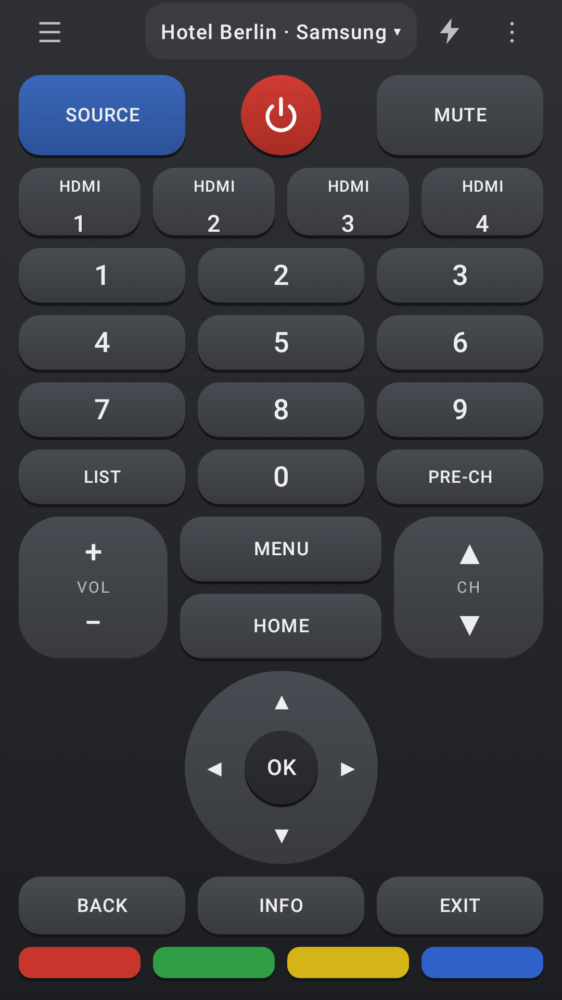<br><sub>Fernbedienung mit HDMI-Reihe</sub></td>
    <td align="center">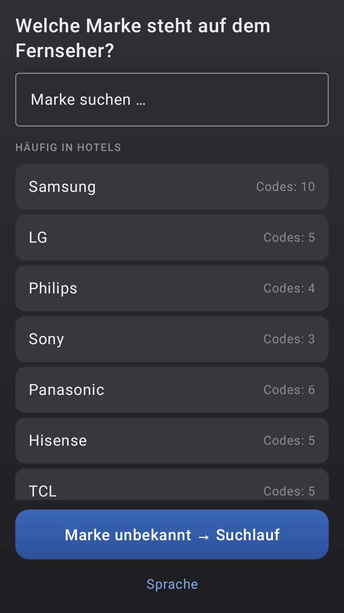<br><sub>Assistent: Marke wählen</sub></td>
    <td align="center">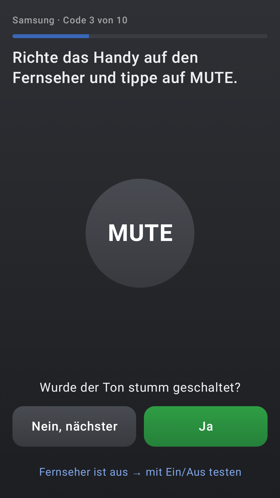<br><sub>Assistent: Code testen</sub></td>
    <td align="center">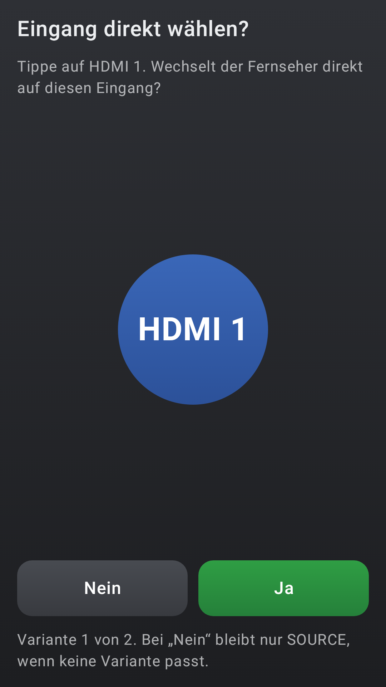<br><sub>Assistent: HDMI-Eingänge</sub></td>
  </tr>
  <tr>
    <td align="center">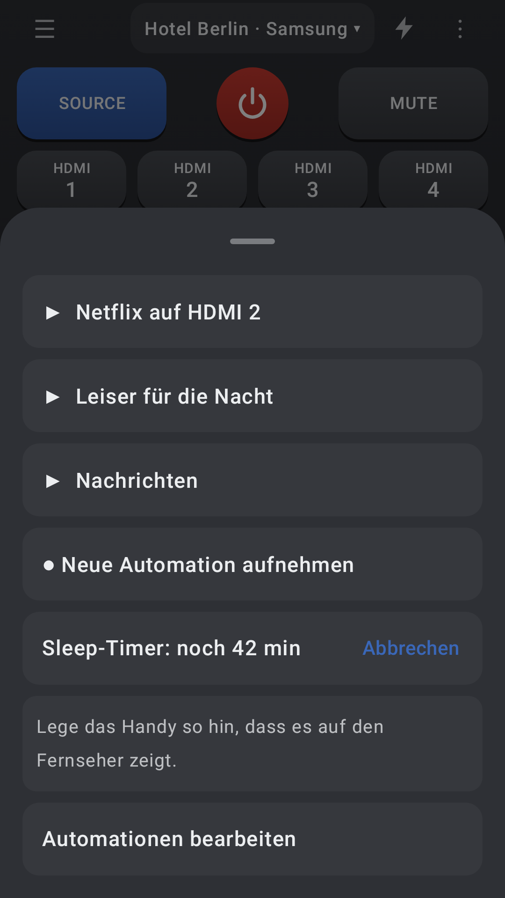<br><sub>⚡-Menü: Automationen und Sleep-Timer</sub></td>
    <td align="center">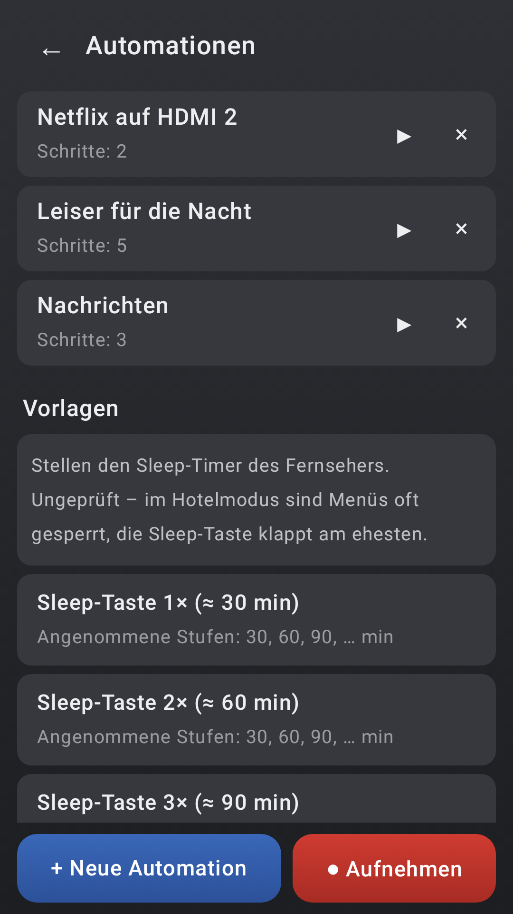<br><sub>Automationen mit Vorlagen</sub></td>
    <td align="center">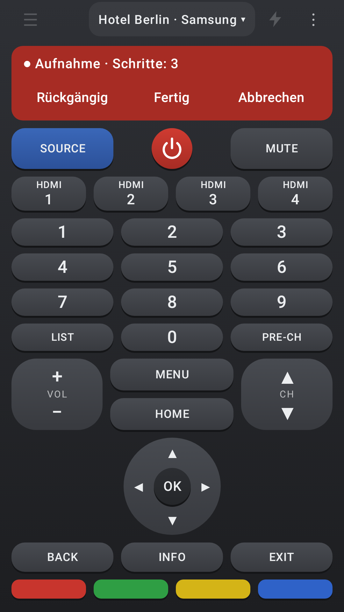<br><sub>Automation aufnehmen</sub></td>
    <td align="center">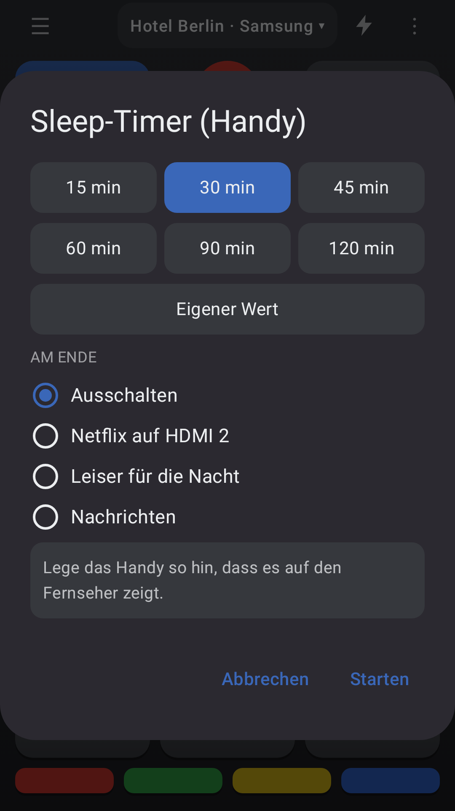<br><sub>Sleep-Timer im Handy</sub></td>
  </tr>
  <tr>
    <td align="center">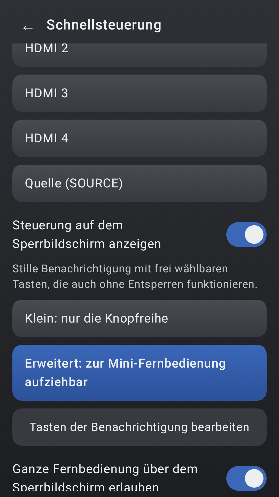<br><sub>Einstellungen Schnellsteuerung</sub></td>
    <td align="center">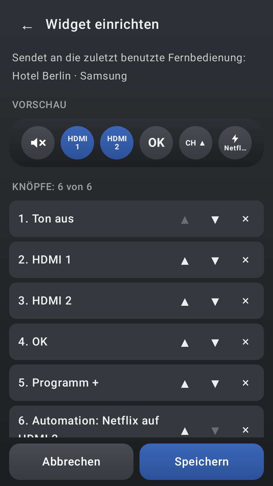<br><sub>Widget einrichten mit Vorschau</sub></td>
    <td align="center">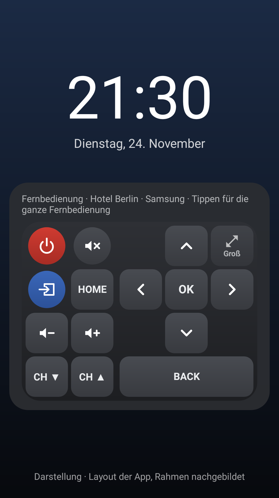<br><sub>Mini-Fernbedienung auf dem Sperrbildschirm (Darstellung)</sub></td>
    <td align="center">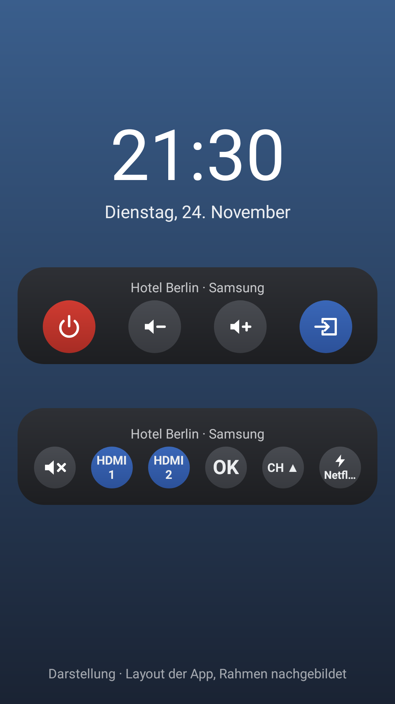<br><sub>Widgets auf dem Startbildschirm (Darstellung)</sub></td>
  </tr>
  <tr>
    <td align="center">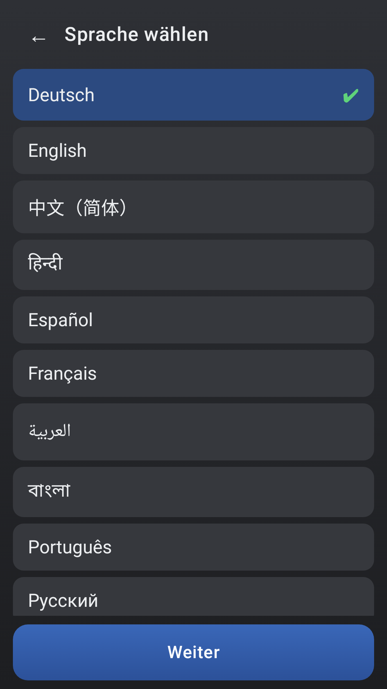<br><sub>11 Sprachen</sub></td>
    <td align="center">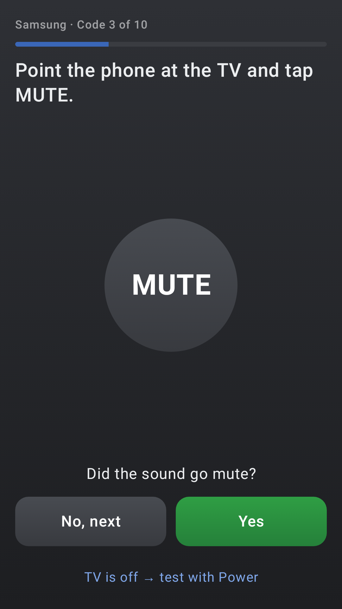<br><sub>Auch auf Englisch</sub></td>
    <td></td>
    <td></td>
  </tr>
</table>

<sub>Bilder aus den echten Bildschirmen der App (Beispiel-Fernbedienung „Hotel Berlin · Samsung“ mit Codes aus der
mitgelieferten Datenbank). „Darstellung“: die Layouts der App in einem nachgebildeten Sperr- bzw. Startbildschirm; das
genaue Aussehen hängt vom Hersteller ab.</sub>

## Voraussetzungen

- **Android 6 oder neuer.**
- **Ein Handy mit Infrarot-Sender** (IR-Blaster), z. B. viele Modelle von Xiaomi, Redmi und POCO sowie einige von
  Huawei und Honor. Ohne IR-Sender zeigt die App einen Hinweis.
- **Ein Fernseher mit Infrarot-Empfänger** – das sind praktisch alle, die mit einer normalen Fernbedienung kommen.

## Installation

1. Die APK von der [neuesten Version](https://github.com/RolufS/IR-Remote-APK/releases/latest) herunterladen.
2. Auf dem Handy öffnen und die Installation aus unbekannten Quellen für den Browser bzw. Dateimanager erlauben.
3. Beim ersten Start die Sprache wählen – danach führt der Assistent zur passenden Fernbedienung.

Per USB: `adb install -r Fernbedienung-1.6.3.apk`

**Xiaomi / Redmi / POCO (MIUI, HyperOS):** Für `adb install` in den Entwickleroptionen „Installation über USB“
einschalten. Damit der Sleep-Timer auch bei geschlossener App zuverlässig auslöst, in den App-Infos unter
„Akku“ die Option **„Keine Einschränkungen“** wählen.

## Datenschutz

Die App erhebt keine Daten, hat keinen Internetzugang und enthält weder Werbung noch Tracking. Gespeicherte
Fernbedienungen liegen nur auf dem Gerät. Details: [PRIVACY.md](PRIVACY.md) (zugleich die Datenschutzerklärung für
den Play Store).

## Bedienung im Detail

<details>
<summary><b>Sprachen</b></summary>

Die App gibt es in 11 Sprachen: Deutsch (Standard, `values/`), Englisch,
Chinesisch (vereinfacht), Hindi, Spanisch, Französisch, Arabisch, Bengalisch,
Portugiesisch, Russisch und Indonesisch (`values-en`, `values-zh-rCN`,
`values-hi`, `values-es`, `values-fr`, `values-ar`, `values-bn`, `values-pt`,
`values-ru`, `values-in`). Beim ersten Start fragt die App nach der Sprache
(vorausgewählt: Systemsprache, sonst Englisch); später lässt sie sich im
⋮-Menü der Fernbedienung oder auf der Markenwahl unter „Sprache“ ändern, ab
Android 13 auch in den Android-Einstellungen der App.

Die Übersetzungen sind maschinell erstellt. Korrekturen sind willkommen –
einfach die passende `app/src/main/res/values-*/strings.xml` ändern; der Test
`TranslationsTest` prüft, dass Namen und Platzhalter (`%1$s`, `%1$d`) zu
`values/strings.xml` passen.

</details>

<details>
<summary><b>Automationen</b></summary>

Eine Automation sendet mehrere Tasten nacheinander, mit einer Wartezeit nach
jedem Schritt (0,5–10 s). Anlegen geht auf zwei Wegen:

- **Liste:** ⋮ → Automationen → „+ Neue Automation“, Tasten einzeln hinzufügen.
- **Aufnahme:** „● Aufnehmen“ in der Automationen-Liste, „● Neue Automation
  aufnehmen“ im ⚡-Sheet oder „● Per Fernbedienung aufnehmen“ im Editor (hängt an
  die vorhandenen Schritte an). Danach einfach die Fernbedienung benutzen – auch
  HDMI-Reihe und ⋮ → „Weitere Tasten“: jede Taste wird normal gesendet und als
  Schritt aufgezeichnet (gehaltene VOL/CH/Pfeile als ein Schritt), die Pause bis
  zur nächsten Taste wird zur Wartezeit (auf 0,5 s gerundet). Die rote Leiste
  zeigt die Schrittzahl, „Rückgängig“ entfernt den letzten Schritt, „Fertig“
  öffnet den Editor (Name eingeben, Wartezeiten anpassen, speichern),
  „Abbrechen“ bzw. Zurück verwirft die Aufnahme nach Rückfrage. Während der
  Aufnahme sind ☰, ⚡ und das Wechseln der Fernbedienung gesperrt.

Ausgeführt wird eine Automation über ⚡ oder ▶ in der Liste.

</details>

<details>
<summary><b>Sleep-Timer-Vorlagen</b></summary>

Unter den Automationen stehen fertige Vorlagen, die den Sleep-Timer **des Fernsehers**
stellen (unabhängig vom Sleep-Timer im Handy):

- **Sleep-Taste** (zuerst, klappt im Hotelmodus am ehesten): für jede Fernbedienung mit
  eigener Sleep-Taste, ≈ 30 / 60 / 90 min. Die Zahl der Drücke richtet sich nach der Marke
  (z. B. Vestel-Familie 10-min-Schritte: 6× für 60 min; LG, Sony, Philips 4×; Samsung 2×).
- **Menüweg** der Marke (Samsung Tizen/TOOLS, LG webOS, Sony Bravia/Google TV, Philips Saphi,
  Panasonic Viera, Hisense VIDAA, TCL Google TV), nur wenn alle nötigen Tasten vorhanden sind.
  „Weitere Vorlagen (andere Marken)“ zeigt die Menüwege anderer Marken.

Ein Tipp öffnet den Editor mit Schritten und Namen; gespeichert wird eine normale Automation.
**Alle Vorlagen sind ungeprüft:** Menüpfade stammen aus Handbüchern oder Foren, die Zahl der
Tastendrücke ist geschätzt – bitte einmal mit „Testen“ prüfen und bei Bedarf anpassen.
Recherche und Quellen: [docs/sleep-timer-research.md](docs/sleep-timer-research.md).
Rückmeldungen (klappt / klappt nicht, mit Marke und Baujahr) gerne als
[Issue](https://github.com/RolufS/IR-Remote-APK/issues).

</details>

<details>
<summary><b>Schnellsteuerung: Kacheln, Widget, Sperrbildschirm</b></summary>

Die wichtigsten Tasten ohne die App zu öffnen. Alle Wege senden an die **zuletzt
benutzte Fernbedienung** (die in der App zuletzt geöffnete). Android erlaubt auf
Handys keine Widgets auf dem Sperrbildschirm; deshalb drei Wege:

- **Kacheln** (ab Android 7): „TV Ein/Aus“, „TV leiser“, „TV lauter“, „TV Eingang“
  und „TV Fernbedienung“ (siehe „Sperrbildschirm“).
  Schnelleinstellungen aufklappen → Bearbeiten (Stift) → Kacheln hineinziehen; ab
  Android 13 auch über ⋮ → Schnellsteuerung → „Kachel … hinzufügen“. Ein Tipp sendet
  sofort, auch auf dem Sperrbildschirm ohne Entsperren (kurzes Vibrieren; bei Fehlern
  ein kurzer Hinweis). Untertitel (ab Android 10): Name der Fernbedienung. Manche
  Hersteller verlangen für Kacheln fremder Apps trotzdem das Entsperren.
- **Widget** (4×1, skalierbar): lange auf den Startbildschirm drücken → Widgets →
  Fernbedienung → „Schnellsteuerung“; ab Android 8 (je nach Launcher) auch über
  „Widget hinzufügen“. Zeigt den Namen der Fernbedienung und 1–6 runde Knöpfe;
  ein Tipp auf den Namen öffnet die App. Beim Hinzufügen öffnet sich „Widget
  einrichten“ (ab Android 12 optional, dann gilt sofort die Standardbelegung
  Ein/Aus · leiser · lauter · Eingang). Jedes Widget hat eine eigene Belegung, z. B.
  ein Lautstärke- und ein HDMI-Widget nebeneinander. Später ändern: ⋮ →
  Schnellsteuerung → Abschnitt „Widget“ → „Bearbeiten“, ab Android 12 auch lange auf
  das Widget drücken → bearbeiten.
- **Sperrbildschirm-Benachrichtigung** (Standard aus): ⋮ → Schnellsteuerung →
  „Steuerung auf dem Sperrbildschirm anzeigen“. Stille, dauerhafte Benachrichtigung
  im Kanal „Schnellsteuerung“ mit 1–5 Knöpfen (eigene Belegung: „Tasten der
  Benachrichtigung bearbeiten“), die ohne Entsperren senden; ab
  Android 13 fragt die App nach der Erlaubnis für Benachrichtigungen. Nach einem
  Neustart erscheint sie wieder. Ab Android 14 lässt sie sich entsperrt wegwischen;
  beim nächsten Öffnen der App kommt sie zurück.

**Sperrbildschirm.** Echte Widgets auf dem Sperrbildschirm gibt es auf Android-Handys nicht. Deshalb zwei
Wege, beide ohne Entsperren:

- **Aufziehbare Benachrichtigung**: unter „Steuerung auf dem Sperrbildschirm anzeigen“
  die Ansicht wählen. **Klein** zeigt nur die Knopfreihe, **Erweitert** (Standard) lässt
  sich zusätzlich herunterziehen zur **Mini-Fernbedienung** mit großen Tasten in zwei
  Spalten: links Ein/Aus · Stumm, Eingang · HOME, Lautstärke −/+ und CH ▼/▲, rechts das
  Steuerkreuz mit OK und darunter BACK. Tasten, die der
  zuletzt benutzten Fernbedienung fehlen, sind ausgeblendet. Eingeklappt bleibt die frei
  gewählte Knopfreihe.
- **Ganze Fernbedienung über dem Sperrbildschirm** (Standard aus): Schalter „Ganze
  Fernbedienung über dem Sperrbildschirm erlauben“. Dann öffnet das Tippen auf die
  Sperrbildschirm-Benachrichtigung selbst (Kopfzeile oder freie Fläche, Hinweis „Tippen für die
  ganze Fernbedienung“) oder die Kachel „TV Fernbedienung“ die normale Fernbedienung der
  zuletzt benutzten Fernbedienung über dem Sperrbildschirm, ohne zu entsperren. Einen eigenen
  Knopf dafür gibt es nicht: Android verlangt bei Knöpfen in der Benachrichtigung immer das
  Entsperren, nur das Tippen auf die Benachrichtigung selbst darf über dem Sperrbildschirm
  öffnen. Als Hinweis zeigt die Benachrichtigung dann ein Symbol „Groß“ (⤢) ohne eigene
  Funktion – oben rechts im Steuerkreuz und klein am Ende der Knopfreihe; ein Tippen darauf ist
  ein Tippen auf die Benachrichtigung. Die Kachel öffnet ab Android 14 ohne Entsperren; vor Android 14 fragt das System
  dort zuerst nach dem Entsperren. Dort gibt es nur Tasten und ⋮ → „Weitere
  Tasten“: kein ☰, kein Wechseln, kein ⚡, keine Automationen, kein Assistent, keine
  Einstellungen. Zurück oder die Ein/Aus-Taste des Handys schließt sie; wer dabei entsperrt,
  kann weiter bedienen, die volle App öffnet sich wie gewohnt über den Launcher. Wer das
  Handy in der Hand hat, kann damit den Fernseher bedienen – sonst nichts. Ist die Option
  aus, ist die Kachel ausgegraut („In der App aktivieren“).

**Belegung** (Widget und Benachrichtigung): jede Taste der zuletzt benutzten
Fernbedienung (Gruppen „Häufig“, „Alle Tasten“, „Weitere Tasten“ mit den Extra-Tasten
wie „Netflix“), „Eingang“ oder eine Automation dieser Fernbedienung. Automationen laufen
direkt im Hintergrund (wie beim Sleep-Timer) und dürfen höchstens 8 s Wartezeit haben;
längere sind in der Auswahl gesperrt. Bekannte Tasten zeigen ein Symbol (Ein/Aus rot,
Lautsprecher −/+, Stumm, Pfeile), HDMI und SOURCE sind blau, Farbtasten farbig, alle anderen
tragen eine kurze Beschriftung (höchstens 6 Zeichen), Automationen einen Blitz mit Namen.
Fehlt die Taste oder Automation bei der aktuellen Fernbedienung (andere Marke), erscheint ein
kurzer Hinweis. Die Kacheln bleiben fest belegt.

**Eingang** sendet die in ⋮ → Schnellsteuerung gewählte Taste (HDMI 1–4 oder SOURCE,
angeboten werden nur Tasten der aktuellen Fernbedienung), sonst HDMI 1, sonst SOURCE.
Die Wahl gilt für alle Fernbedienungen; fehlt einer die gewählte Taste, greift der
Standard. **Ein/Aus** sendet wie ein kurzer Druck in der App den Umschalter POWER,
sonst „Einschalten“ bzw. „Ausschalten“.

Hinweis: Vor Android 13 erscheinen die Sleep-Timer-Benachrichtigungen in der
Systemsprache, nicht in der in der App gewählten Sprache (die App-Sprache gilt
dort nur für die Bildschirme der App).

</details>

## Für Entwickler

<details>
<summary><b>Code-Überblick Schnellsteuerung</b></summary>

Code: `app/src/main/java/de/hotelremote/quick/` (Kacheln `QuickTileService.kt`, Widget
`QuickWidgetProvider.kt`, Einrichten `WidgetConfigActivity.kt`, Benachrichtigung
`QuickNotification.kt` mit Mini-Fernbedienung `MiniRemoteViews.kt`, ganze Fernbedienung über
dem Sperrbildschirm `LockScreenRemoteActivity.kt`, Knöpfe `QuickControlReceiver.kt`, Belegung `QuickButton.kt` und
`QuickButtonLook.kt`), Einstellungen `ui/quick/QuickControlsScreen.kt` und
`ui/quick/QuickButtonsEditor.kt`, Layouts `res/layout/widget_quick.xml` (bis 4 Knöpfe),
`widget_quick_dense.xml` (5–6), `notification_quick.xml` und `notification_quick_big.xml`,
Widget-Info
`res/xml/quick_widget_info.xml`.

</details>

<details>
<summary><b>App bauen und signieren</b></summary>

```
./gradlew :app:assembleRelease
mkdir -p dist
cp app/build/outputs/apk/release/app-release.apk dist/Fernbedienung-1.6.3.apk
```

Gradle legt `app/build/outputs/apk/release/app-release.apk` an; die Kopie unter
`dist/Fernbedienung-1.6.3.apk` ist die Datei zum Installieren (`dist/` steht nicht
im Repo). Installieren per USB: `adb install -r dist/Fernbedienung-1.6.3.apk`.

Zum Signieren stehen
in `~/.gradle/gradle.properties` (außerhalb des Repos) vier Properties:
`HOTELREMOTE_STORE_FILE`, `HOTELREMOTE_STORE_PASSWORD`, `HOTELREMOTE_KEY_ALIAS`,
`HOTELREMOTE_KEY_PASSWORD`. `HOTELREMOTE_STORE_FILE` muss ein absoluter Pfad
sein (kein `~`; ein relativer Pfad würde relativ zu `app/` aufgelöst).
Fehlen sie, wird unsigniert gebaut (mit Warnung).
Den Schlüssel anlegen: `keytool -genkeypair -keystore ~/.android/hotelremote.jks -alias hotelremote -keyalg RSA -keysize 4096 -validity 36500 -dname "CN=Fernbedienung"`.

</details>

<details>
<summary><b>Play Store und Grafiken</b></summary>

Für den Play Store wird ein App Bundle (AAB) hochgeladen. Es wird mit demselben
Schlüssel signiert wie das APK (Properties wie oben):

```
./gradlew :app:bundleRelease
mkdir -p dist
cp app/build/outputs/bundle/release/app-release.aab dist/Fernbedienung-1.6.3.aab
```

Play App Signing: Beim ersten Upload in der Play Console „Play App Signing“
aktiv lassen. Google erzeugt und verwaltet dann den eigentlichen App-Signaturschlüssel;
`~/.android/hotelremote.jks` dient als Upload-Schlüssel. Mit diesem Schlüssel
müssen alle späteren Bundles signiert sein – Keystore und Passwörter sicher
aufbewahren (nicht im Repo). Store-Texte, Formular-Antworten und Grafiken liegen
unter `docs/play-store/`.

Grafiken neu erzeugen:

```
# App-Icon (Vektor + Legacy-PNGs), icon-512.png, feature-graphic.png (benötigt Pillow)
tools/.venv/Scripts/python tools/make_graphics.py
# Screenshots 1080 x 1920 aus den echten Compose-Bildschirmen (Robolectric, ohne Emulator):
# Store-Bilder nach docs/play-store/, Bilder dieser Seite nach docs/screenshots/
./gradlew :app:testDebugUnitTest --tests de.hotelremote.StoreScreenshots -Pscreenshots
```

Ohne `-Pscreenshots` wird der Screenshot-Test übersprungen.

</details>

<details>
<summary><b>Code-Datenbank neu bauen (und irdb)</b></summary>

```
bash tools/fetch_sources.sh
tools/.venv/Scripts/python tools/build_codes.py --flipper tools/sources/flipper --out app/src/main/assets/codes.db
```

Danach die App neu bauen.

**irdb (optional):** Mit `--irdb tools/sources/irdb` fließen zusätzlich Codes aus irdb ein. Deren
Lizenz verlangt, vorher ein Issue beim irdb-Projekt zu eröffnen und in der App
einen Hinweis anzuzeigen. Der Info-Bildschirm zeigt den Hinweis automatisch,
wenn irdb enthalten ist. Der Standard-Build verwendet irdb nicht.

</details>

<details>
<summary><b>Prüfliste am Gerät (mit echtem Fernseher)</b></summary>

1. Erster Start fragt nach der Sprache, danach öffnet sich der Wizard.
2. Die Marke des eigenen TVs wird gefunden, MUTE schaltet stumm.
3. Bestätigungstest und Eingangs-Test laufen.
4. Speichern führt zur Fernbedienung, HDMI-Reihe je nach Ergebnis.
5. VOL halten zählt hoch und stoppt beim Loslassen.
6. Die App neu starten öffnet die letzte Fernbedienung.
7. Der Suchlauf schaltet den TV aus, der Stopp mit Kandidatenprüfung schaltet ihn wieder an.
8. Flugmodus an: Alles funktioniert unverändert.
9. ⋮ → Sprache → z. B. English: Texte wechseln, die gespeicherten Fernbedienungen bleiben.
10. ⋮ → Automationen → „+ Neue Automation“: Name, Schritte (z. B. Menü, Pfeil runter, OK)
    mit Wartezeiten, „Testen“ sendet die Folge, Speichern. Über ⚡ startet ein Tipp die
    Automation; die Leiste zeigt „Schritt i von n“, „Abbrechen“ stoppt, der Bildschirm bleibt an.
11. Automationen → „● Aufnehmen“: Menü, Pfeil runter (kurz warten), OK drücken – der TV
    reagiert jeweils, die Leiste zählt „Schritte: 3“. VOL+ halten ergibt einen Schritt,
    „Rückgängig“ entfernt ihn. „Fertig“ zeigt die Schritte mit den gemessenen Wartezeiten;
    Name eingeben, speichern, über ⚡ ausführen: gleiche Folge wie aufgenommen.
12. ⚡ → Sleep-Timer (Handy) → eigener Wert 2 min, „Ausschalten“: Akku-Hinweis (nur beim
    ersten Mal), ab Android 14 Frage nach „Wecker und Erinnerungen“, ab Android 13 nach
    Benachrichtigungen. Die Benachrichtigung zählt herunter; App schließen (aus „Zuletzt
    verwendet“ wischen), Handy sperren und auf den TV legen: nach 2 min geht der TV aus,
    danach „Sleep-Timer ausgeführt“.
13. Timer starten und über „Abbrechen“ in der Benachrichtigung beenden: nichts wird gesendet.
14. Timer mit 10 min starten, Handy neu starten: der Timer läuft weiter und löst aus.
15. Auf Xiaomi/HyperOS: Akku „Keine Einschränkungen“ setzen und Punkt 12 wiederholen.
16. Kacheln: Schnelleinstellungen → Bearbeiten → die vier TV-Kacheln (Ein/Aus, leiser, lauter, Eingang) hinzufügen (ab Android 13
    auch über ⋮ → Schnellsteuerung). Untertitel zeigt die Fernbedienung. Handy sperren,
    Schnelleinstellungen vom Sperrbildschirm aufklappen: Ein/Aus, leiser, lauter und Eingang
    wirken am TV ohne Entsperren, das Handy vibriert kurz.
17. ⋮ → Schnellsteuerung → Eingangstaste z. B. HDMI 2: die Kachel „TV Eingang“ schaltet auf HDMI 2.
18. Widget hinzufügen (lange auf den Startbildschirm drücken oder „Widget hinzufügen“): „Widget
    einrichten“ öffnet sich (vor Android 12 immer). „Abbrechen“: vor Android 12 wird kein Widget
    angelegt. „Speichern“ mit der Standardbelegung: die vier Knöpfe senden; in der App auf eine
    andere Fernbedienung wechseln oder sie umbenennen – der Name im Widget ändert sich.
19. Zweites Widget mit z. B. Stumm, HDMI 1, HDMI 2, „Netflix“ (Extra-Taste), OK und einer
    Automation „Sleep 60“ (6 Knöpfe, Vorschau prüfen): das Widget zeigt sechs kleinere Knöpfe mit
    Symbol bzw. Beschriftung, jeder sendet; die Automation läuft komplett, auch bei gesperrtem
    Handy. Eine Automation mit mehr als 8 s Wartezeit ist in der Auswahl ausgegraut („zu lang
    für das Widget“). Das erste Widget ist unverändert.
20. ⋮ → Schnellsteuerung → „Widget“: beide Widgets stehen in der Liste („Widget 2 · Tasten: 6“);
    „Bearbeiten“, Reihenfolge ändern, speichern: das Widget folgt sofort. Ab Android 12 auch
    lange auf das Widget drücken → bearbeiten. Widget entfernen: es verschwindet aus der Liste.
21. In der App auf eine Fernbedienung einer anderen Marke ohne HDMI 2 wechseln, im Widget HDMI 2
    tippen: Hinweis „Diese Taste fehlt der Fernbedienung.“; fehlende Automation entsprechend.
22. Philips-TV (RC5/RC6): Stumm im Widget zweimal tippen (dazwischen App aus „Zuletzt
    verwendet“ wischen): der TV schaltet beide Male um.
23. ⋮ → Schnellsteuerung → „Steuerung auf dem Sperrbildschirm anzeigen“ (ab Android 13 mit
    Erlaubnisfrage): stille Benachrichtigung mit vier Knöpfen; auf dem Sperrbildschirm senden
    sie ohne Entsperren. „Tasten der Benachrichtigung bearbeiten“ (höchstens 5): die
    Benachrichtigung zeigt die neue Belegung. Handy neu starten: die Benachrichtigung ist wieder
    da. Schalter aus: sie verschwindet.
24. Alle Fernbedienungen löschen: Kacheln sind ausgegraut („Keine Fernbedienung“), das Widget
    zeigt „Keine Fernbedienung“.
25. Sperrbildschirm-Benachrichtigung an, Ansicht „Erweitert“: Handy sperren, die Benachrichtigung
    herunterziehen: die Mini-Fernbedienung erscheint zweispaltig mit hohen Tasten (nichts
    abgeschnitten). Ein/Aus, Stumm,
    Eingang, −/+, CH ▲/▼, Pfeile, OK, BACK, HOME senden ohne Entsperren. Bei einer
    Fernbedienung ohne z. B. HOME fehlt der Knopf. Ansicht „Klein“: nur die Knopfreihe, kein
    Aufziehen.
26. „Ganze Fernbedienung über dem Sperrbildschirm erlauben“ an: die Kopfzeile der
    Benachrichtigung zeigt „Tippen für die ganze Fernbedienung“, ein eigener Knopf ist nicht mehr
    da. Handy sperren, auf die Benachrichtigung (Kopfzeile oder freie Fläche, nicht auf eine
    Taste) tippen: keine Entsperr-Abfrage, die
    Fernbedienung öffnet sich über dem Sperrbildschirm ohne Entsperren, nur mit ⋮ → „Weitere
    Tasten“; VOL halten zählt hoch. Zurück: der Sperrbildschirm ist wieder da. Erneut öffnen,
    Ein/Aus-Taste des Handys: Bildschirm aus, nach dem Einschalten der Sperrbildschirm. Ohne
    gespeicherte Fernbedienung: Hinweis „Noch keine Fernbedienung – App öffnen“.
27. Kachel „TV Fernbedienung“ hinzufügen (ab Android 13 auch über ⋮ → Schnellsteuerung): bei
    ausgeschalteter Option ausgegraut mit „In der App aktivieren“; eingeschaltet öffnet ein Tipp
    auf dem Sperrbildschirm die ganze Fernbedienung (ab Android 14 ohne Entsperr-Abfrage, vorher
    mit). Die Tasten der Mini-Fernbedienung senden weiter ohne Entsperren. Option wieder aus:
    Tippen auf die Benachrichtigung öffnet die App (nach dem Entsperren), die Kachel ist ausgegraut.

</details>

## English

**Fernbedienung** ("TV Remote") turns an Android phone with an infrared blaster into a remote control for hotel
TVs – no ads, no tracking, no internet permission. A short wizard finds the right code: pick the brand, tap MUTE
and say whether the TV reacted; for unknown brands a scan sends power-off codes until the TV switches off. The
remote has number keys, a D-pad, color keys and – if the TV supports it – direct HDMI 1–4 keys, handy for a Fire TV
Stick. Automations send several keys with one tap and can be recorded simply by using the remote; templates help
set the TV's own sleep timer, and a phone-side sleep timer turns the TV off even when the app is closed. Quick
Settings tiles, a home-screen widget with freely assignable buttons and an expandable lock-screen notification
(optionally opening the full remote over the lock screen) work without opening the app. The app is available in 11
languages and needs Android 6+ and a phone with an IR emitter (e.g. many Xiaomi, Redmi and POCO models).

[**Download the latest APK**](https://github.com/RolufS/IR-Remote-APK/releases/latest) · [Privacy policy (German)](PRIVACY.md)

## Quellen und Lizenz

- Der Code steht unter der [MIT-Lizenz](LICENSE).
- Die Infrarot-Codes in `app/src/main/assets/codes.db` stammen aus der
  [Flipper-IRDB](https://github.com/Lucaslhm/Flipper-IRDB) (CC0-1.0).
- Quellen der Sleep-Timer-Vorlagen: [docs/sleep-timer-research.md](docs/sleep-timer-research.md).
